# wifi-ofdm-linksim

An 802.11a-style OFDM physical-layer link simulator written in MATLAB. It
runs on MATLAB or GNU Octave and needs no toolboxes. It covers the whole chain from payload bits to
decoded bits: scrambler, K=7 convolutional code with puncturing, block
interleaver, Gray QAM, OFDM with pilots and cyclic prefix, a multipath
channel with carrier frequency offset (CFO) and AWGN, and a blind
receiver that does preamble synchronisation, channel estimation, pilot
phase tracking, soft demapping and Viterbi decoding.

The aim is to measure link-level behaviour (BER, packet error rate, required SNR
per modulation and coding scheme, synchronisation accuracy) with code that is
small enough to read end to end.

## Running it

You need MATLAB or GNU Octave (tested with Octave 8.4 on Ubuntu 24.04). No toolboxes are used.

```sh
# tests (exits non-zero on failure)
octave-cli --no-gui --eval "addpath('tests'); n = run_all_tests(); exit(double(n > 0));"

# benchmark: quick smoke run (~2 min), or full run that writes bench/results.md
octave-cli --no-gui --eval "addpath('bench'); run_benchmark('quick');"
octave-cli --no-gui --eval "addpath('bench'); run_benchmark('full');"
```

In MATLAB: `addpath tests; run_all_tests` and `addpath bench; run_benchmark('full')`.

A single packet by hand:

```matlab
addpath src
mcs  = mcs_table(5);                          % 16-QAM, rate 1/2, 24 Mb/s
bits = double(rand(8*100, 1) > 0.5);          % 100-byte PSDU
x    = phy_tx(bits, mcs);
r    = channel_tdl(x, struct('snr_db', 18, 'rms_delay', 2, 'cfo_hz', 50e3, 'lead', 37));
llr  = phy_rx_front(r, mcs, 100);             % sync, estimate, equalise, demap
rx   = phy_rx_decode(llr, 100);               % Viterbi + descramble
nnz(rx ~= bits)
```

`link_sim(mcs_idx, snr_list, chan, npkts, psdu_bytes)` runs the Monte Carlo
loop and returns PER and BER per SNR point.

## Architecture

```mermaid
flowchart LR
  subgraph TX[phy_tx]
    A[PSDU bits] --> B[SERVICE + tail + pad] --> C[scrambler<br/>x^7+x^4+1]
    C --> D[conv_encode<br/>K=7, 133/171] --> E[puncture<br/>1/2, 2/3, 3/4]
    E --> F[interleave<br/>per symbol] --> G[qam_map<br/>Gray, unit energy]
    G --> H[ofdm_mod<br/>48 data + 4 pilots, CP 16]
    P[preamble<br/>STF + LTF] --> I((+))
    H --> I
  end
  I --> CH[channel_tdl<br/>Rayleigh TDL, CFO,<br/>timing offset, AWGN]
  subgraph RX[phy_rx_front]
    CH --> S1[sync_coarse<br/>STF delay-correlate, CFO]
    S1 --> S2[sync_fine<br/>LTF x-corr timing, fine CFO]
    S2 --> S3[LS channel + noise<br/>estimate from 2 LTFs]
    S3 --> S4[ofdm_demod, equalise,<br/>pilot phase tracking]
    S4 --> S5[qam_demap_llr<br/>max-log, per-subcarrier noise]
    S5 --> S6[deinterleave, depuncture]
  end
  subgraph DEC[phy_rx_decode]
    S6 --> V[viterbi_decode<br/>batched over packets] --> W[seed recovery,<br/>descramble] --> Z[PSDU bits]
  end
```



| File | Role |
|---|---|
| `src/mcs_table.m` | The eight 802.11a rates (6–54 Mb/s) |
| `src/scrambler.m`, `scrambler_seed_from_service.m` | 127-period scrambler; receiver recovers the seed from the zero SERVICE bits |
| `src/conv_encode.m`, `puncture.m`, `depuncture.m` | Rate-1/2 mother code and 802.11a puncturing; erasures become zero LLRs |
| `src/viterbi_trellis.m`, `viterbi_decode.m` | Soft-input Viterbi decoder. Path metrics are a 64 x P matrix, so P packets share one add-compare-select loop |
| `src/interleaver_index.m`, `interleave.m`, `deinterleave.m` | Two-step 802.11a interleaver |
| `src/qam_map.m`, `qam_demap_llr.m`, `pam_gray_levels.m` | Gray BPSK/QPSK/16/64-QAM; max-log LLRs computed per PAM axis |
| `src/ofdm_params.m`, `preamble.m`, `ofdm_mod.m`, `ofdm_demod.m` | 64-point FFT numerology, STF/LTF, pilot polarity sequence |
| `src/channel_tdl.m` | Block-fading tapped delay line with exponential power-delay profile, CFO, AWGN |
| `src/sync_coarse.m`, `sync_fine.m` | Schmidl-Cox style STF correlator; LTF cross-correlation timing with a 4-sample back-off into the CP |
| `src/phy_rx_front.m`, `phy_rx_decode.m` | Receiver. A "genie" option bypasses sync and estimation to measure their loss |
| `src/link_sim.m`, `ber_theory_awgn.m` | Monte Carlo driver and closed-form uncoded BER |

Two design choices worth pointing out:

- **Batched Viterbi.** An interpreted language pays per-statement overhead.
  The decoder runs each trellis step once for every packet in the batch, so the cost is
  shared across packets. The benchmark measures the speed-up below.
- **Decoding stops at the tail.** The pad bits after the 6 tail bits are
  scrambled, so the encoder does not end in state 0. The decoder drops the
  coded bits after the tail and traces back from state 0 at that point.
  Tracing back from the end of the stream put errors into the last PSDU
  bits. `test_end_to_end` has a regression test for this.

## Tests

`tests/run_all_tests.m` runs 9 test files (`test_*.m`). They include:
known-answer checks against the standard (generator impulse response, the
scrambler prefix `0000 1110 1111 0010`, the pilot polarity prefix, the BPSK
interleaver formula, the 16-QAM level table), and structural properties
(m-sequence period and balance, Gray adjacency, interleaver permutation and
subcarrier separation, the CP absorbing multipath shorter than 16 samples).
Others check decoding: correcting any 4 hard errors (free distance 10), soft
decoding beating hard decoding, and batched results matching per-packet
results. Statistical tests check uncoded BER against theory within 15 %. End-to-end
tests decode all 8 MCS blind through multipath plus a 90 kHz CFO, and check
that pilot tracking removes a residual CFO (the same packet fails with tracking off).
The suite passed for RNG seeds 1–12.

## Benchmark results

Full output: [`bench/results.md`](bench/results.md). Produced with

```sh
octave-cli --no-gui --eval "addpath('bench'); run_benchmark('full');"
```

This run used GNU Octave 8.4.0 in an Ubuntu 24.04 container (4 vCPUs, arm64
host) and took 229 s. SNR is per time-domain sample. The per-subcarrier SNR is
0.90 dB higher.

**Uncoded BER vs theory** (AWGN, 2e6 bits per point, 12 points from BPSK to
64-QAM): the largest deviation from the closed-form value was 3.4 %.

**SNR (dB) needed for PER ≤ 10 %**, 100-byte PSDU, 200 packets per point, 1 dB
grid. Each packet has a random start offset (0–100 samples) and a CFO drawn
uniformly from ±100 kHz. Multipath is Rayleigh block fading with 100 ns RMS
delay spread:

| MCS | Mode | Mb/s | AWGN, blind RX | Multipath, blind RX | Multipath, genie RX | Sync + estimation loss |
|---|---|---|---|---|---|---|
| 1 | BPSK 1/2 | 6 | 3 | 7 | 5 | 2 |
| 2 | BPSK 3/4 | 9 | 4 | 11 | 9 | 2 |
| 3 | QPSK 1/2 | 12 | 6 | 10 | 8 | 2 |
| 4 | QPSK 3/4 | 18 | 8 | 13 | 12 | 1 |
| 5 | 16-QAM 1/2 | 24 | 10 | 15 | 13 | 2 |
| 6 | 16-QAM 3/4 | 36 | 14 | 19 | 17 | 2 |
| 7 | 64-QAM 2/3 | 48 | 18 | 23 | 21 | 2 |
| 8 | 64-QAM 3/4 | 54 | 19 | 24 | 22 | 2 |

In multipath, BPSK 3/4 needs more SNR than QPSK 1/2. The likely reason is
that the punctured rate-3/4 code collects less frequency diversity across faded subcarriers than the
rate-1/2 code does. The blind receiver loses 1–2 dB against the genie. That figure
includes both synchronisation and least-squares channel estimation; the
benchmark does not separate the two.

**Synchronisation** (multipath, 400 packets per SNR):

| SNR (dB) | CFO RMSE | Timing inside ISI-free window |
|---|---|---|
| 0 | 47909 Hz | 93.2 % |
| 5 | 4327 Hz | 98.5 % |
| 10 | 2187 Hz | 99.2 % |
| 20 | 854 Hz | 98.5 % |

At 0 dB the CFO RMSE is dominated by a few outliers where the coarse estimate
is wrong.

**Speed** (64 packets of 500 bytes, 64-QAM 3/4):

| Stage | Result |
|---|---|
| Viterbi, one packet per call | 0.05 Mbit/s |
| Viterbi, 64 packets batched | 0.96 Mbit/s (17.6x faster) |
| Full receive chain | 12.41 ms per packet |

These speeds come from a single-threaded interpreter and are useful only for comparing
the two Viterbi modes. They say nothing about real-time capability.

## Limitations

- No SIGNAL field: the receiver is told the MCS and PSDU length.
- No packet detection threshold. The receiver assumes a packet is present
  in its 400-sample search window, so false alarms and missed detections are
  not modelled.
- The channel is constant over a packet (block fading). There is no Doppler,
  phase noise, sampling clock offset, IQ imbalance, PA non-linearity or
  ADC quantisation.
- Channel estimation is plain least squares on the two LTFs, with no
  frequency-domain smoothing.
- Max-log LLRs and a floating-point Viterbi decoder; nothing is fixed-point.
- Required SNR is on a 1 dB grid with 200 packets per point, so each entry
  is uncertain by about ±1 dB.
- Developed and tested on GNU Octave. The code sticks to the common
  MATLAB/Octave subset (no toolboxes, no Octave-only syntax), but it has not been run on MATLAB.
